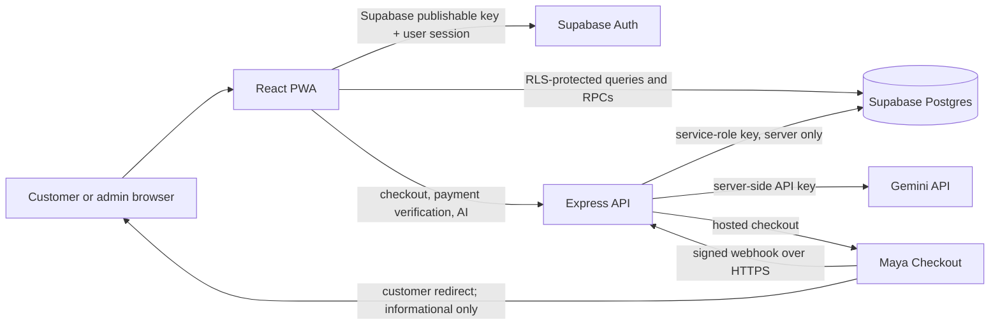

# System architecture



The browser uses Supabase Auth and Postgres for ordinary app data. Row Level Security protects user and admin access. Transaction-critical changes use database functions that validate role and ownership; the Express service-role key and Maya credentials never enter the browser bundle.

## Checkout sequence

```mermaid
sequenceDiagram
  actor Customer
  participant UI as React app
  participant DB as Supabase Postgres
  participant API as Express API
  participant PM as Maya Checkout
  Customer->>UI: Submit shipping and optional coupon
  UI->>DB: Request quote using authenticated RPC
  UI->>API: POST /api/v1/checkout + Supabase access token
  API->>DB: Verify token, lock cart/products/coupon, create order and reserve stock atomically
  API->>PM: Create hosted checkout using server-calculated total
  PM-->>API: Checkout URL and session ID
  API-->>UI: Pending order and checkout URL
  UI->>PM: Redirect to hosted page
  PM-->>UI: Return URL (informational only)
  PM->>API: Signed payment webhook
  API->>PM: Retrieve session and verify paid status, amount, and currency
  API->>DB: Idempotently mark order paid and reservation paid
  Note over UI,API: If webhook is missed, customer can request reconciliation; gateway state is retrieved before the order changes.
```

## Main request path

The client Supabase adapter maps the existing UI API calls to Supabase Auth, queries, and narrowly scoped RPCs. Express exposes only health, Maya checkout/payment verification/webhook, and Gemini discovery endpoints. Errors from Express include a request ID; Supabase errors are surfaced to the UI.
