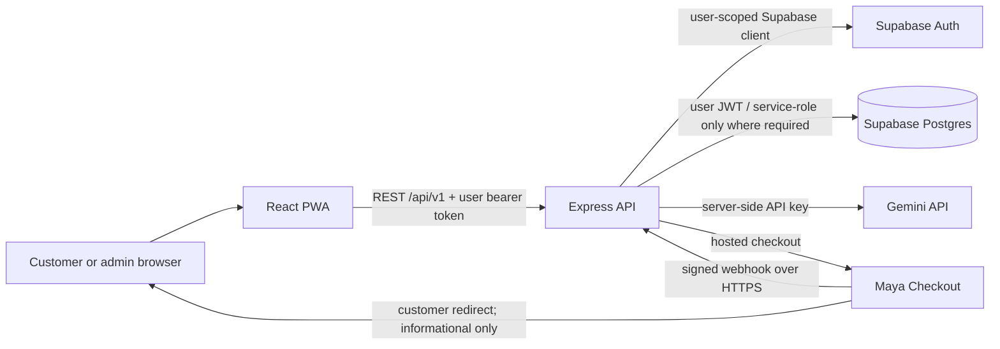

# System architecture



All browser data access goes through Express. Express validates the Supabase session and forwards the user's JWT for ordinary account, catalog, cart, order, and admin operations, preserving RLS and `auth.uid()` checks. Checkout/payment operations that require privileged transactional access remain server-side. Supabase service-role and Maya credentials never enter the browser bundle.

## Checkout sequence

```mermaid
sequenceDiagram
  actor Customer
  participant UI as React app
  participant API as Express API
  participant DB as Supabase Postgres
  participant PM as Maya Checkout
  Customer->>UI: Submit shipping and optional coupon
  UI->>API: POST /api/v1/checkout/quote + bearer token
  API->>DB: Quote using authenticated cart and database prices
  UI->>API: POST /api/v1/checkout + bearer token + idempotency key
  API->>DB: Verify token, lock cart/products/coupon, create pending order and reserve stock atomically
  API->>PM: Create hosted checkout using server-calculated total
  PM-->>API: Checkout URL and session ID
  API-->>UI: Pending order and checkout URL
  UI->>PM: Redirect to hosted page
  PM-->>UI: Return URL (informational only)
  PM->>API: Signed payment webhook
  API->>PM: Retrieve session and verify paid status, amount, and currency
  API->>DB: Idempotently mark order paid and reservation paid
  Note over UI,API: If webhook is missed, customer can request reconciliation; gateway state is retrieved before the order changes.
```

## Main request path

The client API modules centralize the Express contract. Express exposes health, authentication, public products, customer cart/quote/orders, admin operations, Maya checkout/payment verification/webhook, and Gemini discovery. Customer/admin database calls use the verified user's JWT; transaction-critical payment and checkout operations use existing protected database functions. Errors from Express include a request ID and sanitized public messages.
